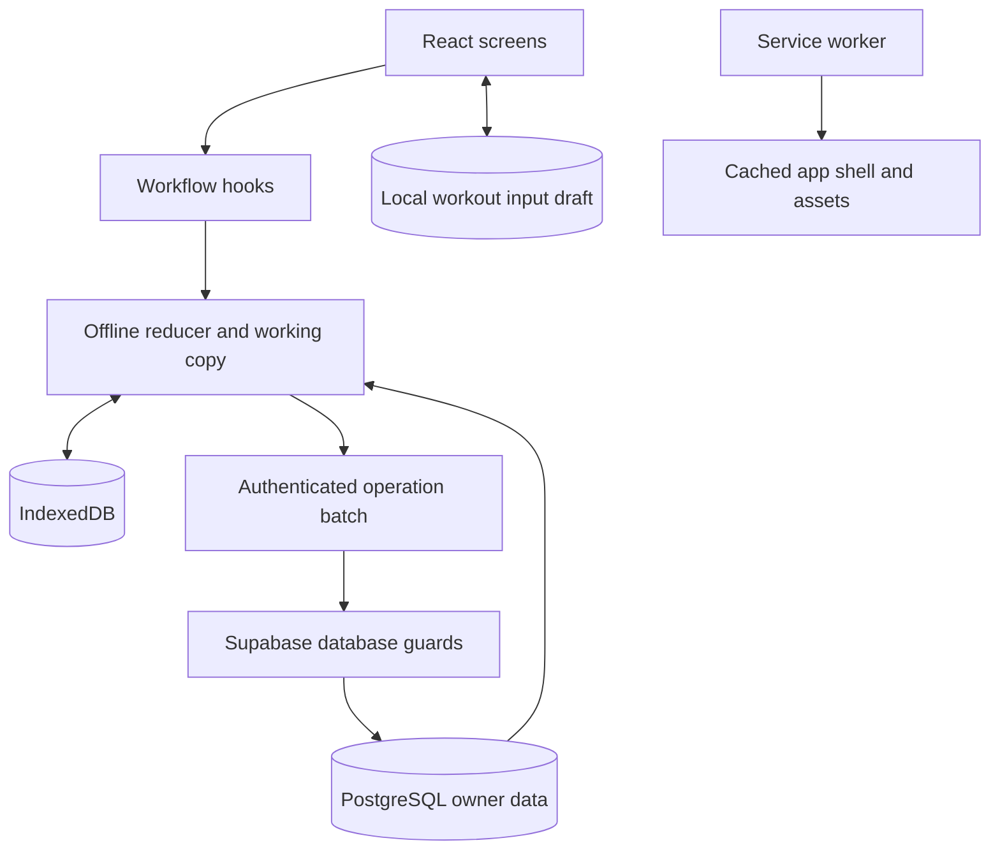

# Architecture

DC Training Log is a React/TypeScript client built by Vite and hosted as static assets on Vercel. Supabase provides email/password authentication and PostgreSQL. The app shell switches views in React; Vercel rewrites paths to `index.html` so account-recovery links reach the app.

## Responsibilities

| Area                 | Source                                                                                    | Responsibility                                                                |
| -------------------- | ----------------------------------------------------------------------------------------- | ----------------------------------------------------------------------------- |
| Entry and access     | `src/App.tsx`, `src/lib/`, `src/hooks/use-auth-session.ts`                                | Session, owner verification, recovery, account-deletion lock                  |
| Screen coordination  | `src/FoundationHome.tsx`                                                                  | Home, rotation, workout, history and settings selection                       |
| Training UI          | `HomeScreen.tsx`, `WorkoutTracer.tsx`, `HistoryScreen.tsx`, `RotationSetup*.tsx` in `src` | Display and user interaction                                                  |
| Accessible modal     | `src/Dialog.tsx`                                                                          | Initial focus, focus containment, background inertness and focus return       |
| Input draft          | `src/hooks/use-workout-draft.ts`                                                          | Owner/workout/step-scoped inputs; storage and successful-submit cleanup       |
| Domain               | `src/workout-domain.ts`, `src/rotation-config.ts`, `src/weight-conversion.ts`             | Entry shapes, catalogue, comparison rules and exact units                     |
| Persistence and sync | `src/offline-sync.ts`, `src/hooks/use-offline-sync.ts`                                    | Durable queue, deterministic local operations, batching and conflict recovery |
| Cloud rules          | `supabase/migrations/`                                                                    | Tables, row security, RPC validation, training rules and account lifecycle    |

## Saved data and interfaces

Assignments are versioned records in `rotation_assignment_versions`; workouts retain their exercise and target context in `workout_steps`. `workouts` and rotation/lifecycle state track the active workout, next slot, and blast. Assignment replacement does not erase completed steps. History and logbook replay use compatible exercise appearances across slots.

The client calls authenticated Supabase RPCs such as `account_sync_status`, `apply_offline_batch`, and `resolve_offline_batch`. A batch contains ordered operations and the expected cloud state counter. The server accepts the entire batch or none, uses operation identities for retry safety, and advances the counter on acceptance. A stale batch enters explicit conflict recovery. Compatibility RPCs also exist; inspect their SQL guards before changing them.

Client and database implementations enforce the same workout rules. A UI-only rule change is insufficient: update the paired SQL behavior and its database tests when the rule is authoritative on the server.

## Trust boundaries

Public browser configuration identifies the project and pins owner verification; it is not a privileged credential. Row-level security and guarded RPCs enforce cloud access. Owner-session validation checks a signed, unexpired token against pinned public keys and the configured owner digest. Account-status checks can lock editing while preserving the mounted app.

The service worker caches static app resources, not a substitute authentication authority. Local storage and IndexedDB belong to one browser profile. A local draft is separate from a committed operation and from confirmed cloud data.

Source: [client modules](https://github.com/mbh-solutions/dc_training/tree/main/src), [database migrations](https://github.com/mbh-solutions/dc_training/tree/main/supabase/migrations), [Vite/PWA configuration](https://github.com/mbh-solutions/dc_training/blob/main/vite.config.ts).
