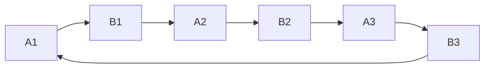

# Workouts and rotation

Home chooses the next workout automatically. Completing a workout advances the rotation once; leaving an unfinished workout does not advance it.

| Slots      | Assigned body parts                                                      |
| ---------- | ------------------------------------------------------------------------ |
| A1, A2, A3 | Chest, shoulders, triceps, back width, back thickness                    |
| B1, B2, B3 | Biceps, forearms, calves, hamstrings, quadriceps, one abdominal exercise |

## Set up a slot

In **ROTATION**, choose the slot and body part, then the exercise. Available prescriptions depend on the exercise. A **DC** badge marks a built-in recommendation; it is not a saved-workout result. Information controls explain relevant technique.

Rest-pause has **one combined target range**, such as 11–15 total reps. Workout entry has three separate fields: RP1, RP2, RP3. Straight sets have the selected number of sets and their individual target ranges. Timed holds use seconds. Review the complete assignment before selecting **SAVE**; **BACK** preserves your selections.

Assignments belong to rotation slots. The same exercise may be assigned to several slots; its compatible previous performance follows the exercise. Changing an assignment preserves saved history.

## Record a workout

- **Weight** accepts a numeric load in the selected unit. **Body weight**, **Bar**, and **Band** are labels without a numeric load; use Weight if you need the actual bar or added load included in the score.
- The prescription stays visible during entry. A compatible prior load is prefilled; performed reps are left blank.
- **SAVE & NEXT** records the step. **SKIP** records an explicit skip. Repeated clicks while saving do not submit another save.
- **PREVIOUS EXERCISE** lets you review and correct an earlier exercise without losing the current entry. **SAVE CHANGES** commits the correction.
- **LEAVE WORKOUT** returns to Home. **RESUME** continues the active workout. Input drafts persist on that browser when storage is available, and clear after a successful save or skip. A draft is not a synced performance.
- **UNDO SAVE**, **UNDO SKIP**, or **UNDO LAST SAVE** appears where the latest operation can be reversed. A required logbook decision must be resolved before progression continues.
- Stretch steps provide an information view and record a duration or skip; they do not provide an automatic rest timer.

## Blast and cruise

A **blast** is the active training phase. **START CRUISE** on Home opens a confirmation, pauses training, and preserves the next slot, assignments, and history. During cruise, History remains available and DC workouts cannot be logged. **START NEW BLAST** resumes the preserved slot. There is no automatic cruise ending or required duration.

After seven elapsed blast weeks, a completed workout can trigger a cruise suggestion on Home. **NOT NOW** dismisses it for that blast. The app does not start cruise for you.

Source: [rotation catalogue](https://github.com/mbh-solutions/dc_training/blob/main/src/rotation-config.ts), [workout screen](https://github.com/mbh-solutions/dc_training/blob/main/src/WorkoutTracer.tsx), [lifecycle logic](https://github.com/mbh-solutions/dc_training/blob/main/src/offline-sync.ts).
